# Microservicio de Calificación de Leads (`calificacion-service`)

**Proyecto Universitario UADE - Desarrollo de Aplicaciones II**

Microservicio responsable del scoring y calificación crediticia y operativa de leads interesados en la compra de vehículos. Implementado siguiendo los principios de **Arquitectura Hexagonal (Ports & Adapters)**, **Domain-Driven Design (DDD)** y **Event-Driven Architecture (EDA)** con Apache Kafka.

---

## Stack Tecnológico
- **Java 21**
- **Spring Boot 3.3.4**
  - Spring Web (MVC)
  - Spring Data JPA
  - Spring Kafka
  - Spring Validation
  - SpringDoc OpenAPI 2.6.0 (Swagger UI)
- **PostgreSQL** (base de datos: `calificacion_db`)
- **Apache Kafka**
- **Lombok**
- **JUnit 5 / AssertJ / Mockito**

---

## Arquitectura Hexagonal

```
com.uade.crm.calificacion
├── domain/                      <- Núcleo del Negocio (Sin dependencias externas)
│   ├── model/                  <- Entidades y Objetos de Valor (Calificacion, DatosNegocio, etc.)
│   ├── reglas/                 <- Patrón Strategy para reglas de scoring (MotorCalificacion)
│   ├── event/                  <- Eventos internos del dominio (CalificacionCalculada)
│   └── port/                   <- Puertos de entrada y salida (VehiculosPort, SituacionCrediticiaPort, etc.)
│
├── application/                <- Capa de Aplicación / Orquestación
│   ├── facade/                 <- CalificacionFacade (coordinador del caso de uso)
│   └── listener/               <- HistorialCalificacionListener (auditoría interna)
│
├── infrastructure/             <- Adaptadores de Infraestructura
│   ├── persistence/            <- JPA, Repositorios y Entidades de DB (PostgreSQL)
│   ├── client/                 <- Adaptadores RestClient hacia microservicios Clientes (8082) y Vehículos (8083)
│   └── messaging/              <- Publicador de eventos en Kafka (LeadCalificadoPublisher)
│
├── api/                        <- Adaptadores Primarios / Entrada
│   ├── controller/             <- Endpoints REST (CalificacionController)
│   ├── consumer/               <- Consumidor de Kafka (PreformularioCompletadoListener)
│   ├── dto/                    <- DTOs de Requests, Responses y Eventos
│   └── advice/                 <- Manejo global de excepciones (RFC 7807 ProblemDetail)
│
└── config/                     <- Configuraciones del Framework y Propiedades
```

---

## 🧩 Patrones de Diseño Implementados

El microservicio implementa **5 patrones de diseño orientados a objetos**, superando el mínimo requerido por la consigna del TPO:

| Patrón | Dónde se aplica | Justificación técnica |
|---|---|---|
| **Strategy** | `ReglaCalificacion`, `ReglaCobertura`, `ReglaFinanciacion`, `ReglaUbicacion` | Permite evaluar criterios de scoring vehicular independientes e intercambiables. Incorporar nuevas reglas respeta el principio *Open/Closed* (OCP) sin modificar el motor. |
| **Factory** | `MotorCalificacionFactory` | Centraliza la construcción y parametrización del motor con umbrales y puntos configurables (`application.yml`) o valores por defecto para pruebas unitarias. |
| **Facade** | `CalificacionFacade` | Oculta la complejidad de orquestar puertos externos (`VehiculosPort`, `SituacionCrediticiaPort`), motor de scoring, persistencia JPA y publicación Kafka. |
| **Observer** | `CalificacionCalculada` y `HistorialCalificacionListener` | Desacopla la auditoría y trazabilidad ante cada cálculo o corrección mediante eventos de aplicación de Spring y Kafka. |
| **Repository** | `CalificacionRepository` y `CalificacionPersistencePort` | Aísla la capa de dominio puro del mapeo relacional de base de datos JPA/Hibernate. |

### Diagrama de Clases UML

```mermaid
classDiagram
    direction TB

    class NivelCalificacion {
        <<enumeration>>
        MUY_POTABLE
        POTABLE
        NO_POTABLE
    }

    class OrigenCalificacion {
        <<enumeration>>
        AUTOMATICA
        MANUAL
    }

    class Calificacion {
        -Long id
        -String leadId
        -String clienteId
        -int puntos
        -NivelCalificacion nivel
        -OrigenCalificacion origen
        -LocalDateTime fechaCalculo
        -String observacion
        -List~MotivoCalificacion~ motivos
    }

    class MotivoCalificacion {
        -String regla
        -int puntos
        -String descripcion
    }

    class DatosNegocio {
        -String leadId
        -String clienteId
        -String vehiculoId
        -BigDecimal precioVehiculo
        -BigDecimal montoAnticipo
        -BigDecimal montoPermuta
        -boolean permutaNoComputable
        -boolean solicitaFinanciacion
        -Integer situacionCrediticia
        -String ubicacion
    }

    class ReglaCalificacion {
        <<interface>>
        +evaluar(DatosNegocio datos) ResultadoRegla
    }

    class ReglaCobertura {
        +evaluar(DatosNegocio datos) ResultadoRegla
    }

    class ReglaFinanciacion {
        +evaluar(DatosNegocio datos) ResultadoRegla
    }

    class ReglaUbicacion {
        +evaluar(DatosNegocio datos) ResultadoRegla
    }

    class MotorCalificacion {
        -List~ReglaCalificacion~ reglas
        -int umbralMuyPotable
        -int umbralPotable
        +calificar(DatosNegocio datos) ResultadoCalificacion
        +determinarNivel(int puntosTotales) NivelCalificacion
    }

    class MotorCalificacionFactory {
        +crearMotorDefault() MotorCalificacion
        +crearMotor(List~ReglaCalificacion~ reglas, int umbralMuy, int umbralPot) MotorCalificacion
    }

    ReglaCalificacion <|.. ReglaCobertura : implements
    ReglaCalificacion <|.. ReglaFinanciacion : implements
    ReglaCalificacion <|.. ReglaUbicacion : implements
    MotorCalificacion o-- ReglaCalificacion : Strategy
    MotorCalificacionFactory ..> MotorCalificacion : Factory
    Calificacion *-- MotivoCalificacion

    class VehiculosPort {
        <<interface>>
        +obtenerPrecioVehiculo(String vehiculoId) Optional~BigDecimal~
    }

    class SituacionCrediticiaPort {
        <<interface>>
        +obtenerSituacionCrediticia(String clienteId) Optional~Integer~
    }

    class CalificacionPersistencePort {
        <<interface>>
        +guardar(Calificacion calificacion) Calificacion
        +buscarUltimaPorLeadId(String leadId) Optional~Calificacion~
        +buscarHistorialPorLeadId(String leadId) List~Calificacion~
    }

    class LeadCalificadoPublisherPort {
        <<interface>>
        +publicar(Calificacion calificacion) void
    }

    class CalificacionFacade {
        -MotorCalificacion motorCalificacion
        -VehiculosPort vehiculosPort
        -SituacionCrediticiaPort situacionCrediticiaPort
        -CalificacionPersistencePort persistencePort
        -LeadCalificadoPublisherPort publisherPort
        -ApplicationEventPublisher eventPublisher
        +calificarLead(PreformularioCompletadoEvent event) Calificacion
        +corregirManualmente(String leadId, CorreccionManualRequest req) Calificacion
        +obtenerUltimaPorLeadId(String leadId) Calificacion
    }

    class CalificacionCalculada {
        -String leadId
        -String clienteId
        -Calificacion calificacion
        -LocalDateTime fecha
    }

    class HistorialCalificacionListener {
        +onCalificacionCalculada(CalificacionCalculada event) void
    }

    CalificacionFacade --> MotorCalificacion : Facade
    CalificacionFacade --> VehiculosPort
    CalificacionFacade --> SituacionCrediticiaPort
    CalificacionFacade --> CalificacionPersistencePort
    CalificacionFacade --> LeadCalificadoPublisherPort
    CalificacionFacade ..> CalificacionCalculada : emite
    HistorialCalificacionListener ..> CalificacionCalculada : Observer

    class VehiculosRestClientAdapter {
        -RestClient vehiculosRestClient
        +obtenerPrecioVehiculo(String id) Optional~BigDecimal~
    }

    class SituacionCrediticiaRestClientAdapter {
        -RestClient clientesRestClient
        +obtenerSituacionCrediticia(String id) Optional~Integer~
    }

    class CalificacionPersistenceAdapter {
        -CalificacionRepository repository
        +guardar(Calificacion c) Calificacion
    }

    class CalificacionRepository {
        <<interface>>
        +findTopByLeadIdOrderByFechaCalculoDesc(String leadId)
    }

    class LeadCalificadoPublisher {
        -KafkaTemplate kafkaTemplate
        +publicar(Calificacion c) void
    }

    VehiculosPort <|.. VehiculosRestClientAdapter
    SituacionCrediticiaPort <|.. SituacionCrediticiaRestClientAdapter
    CalificacionPersistencePort <|.. CalificacionPersistenceAdapter
    CalificacionPersistenceAdapter --> CalificacionRepository : Repository
    LeadCalificadoPublisherPort <|.. LeadCalificadoPublisher

    class CalificacionController {
        -CalificacionFacade calificacionFacade
        +obtenerUltimaCalificacion(String leadId) ResponseEntity
        +realizarCorreccionManual(String leadId, CorreccionManualRequest req) ResponseEntity
    }

    class PreformularioCompletadoListener {
        -CalificacionFacade calificacionFacade
        +escucharPreformulario(PreformularioCompletadoEvent event) void
    }

    CalificacionController --> CalificacionFacade
    PreformularioCompletadoListener --> CalificacionFacade
```



---

## Reglas de Negocio y Scoring

El motor evalúa 3 reglas principales (Strategy):

1. **Regla de Cobertura (`ReglaCobertura`)**:
   - $\text{Cobertura} = \frac{\text{Anticipo} + \text{Permuta Computable}}{\text{Precio Unidad}} \times 100$
   - $\ge 50\%$: **+60 puntos**
   - $20\% \text{ a } 49\%$: **+35 puntos**
   - $> 0\% \text{ a } < 20\%$: **+20 puntos**
   - $0\%$: **0 puntos**
   - *Nota*: Si la permuta está marcada como "clavo" o no computable, su valor computable es 0.

2. **Regla de Financiación (`ReglaFinanciacion`)**:
   - Aplica si `solicitaFinanciacion = true`.
   - Situación BCRA 1 o 2: **+20 puntos**
   - Situación BCRA 3 a 6: **-25 puntos**
   - Sin datos / no solicita: **0 puntos**

3. **Regla de Ubicación (`ReglaUbicacion`)**:
   - Zonas preferenciales: `BUENOS_AIRES`, `CABA`, `BSAS`, `GBA` (**0 puntos**).
   - Fuera de zona: **-25 puntos**.

### Niveles de Calificación:
- $\ge 60$ puntos: **`MUY_POTABLE`**
- $20 \text{ a } 59$ puntos: **`POTABLE`**
- $< 20$ puntos: **`NO_POTABLE`**

---

## Endpoints REST (Puerto 8084)

| Método | Endpoint | Descripción |
|---|---|---|
| `GET` | `/calificaciones/{leadId}` | Obtiene la última calificación vigente del lead (con desglose de motivos) |
| `GET` | `/calificaciones/{leadId}/historial` | Obtiene el historial completo de calificaciones del lead |
| `POST` | `/calificaciones/{leadId}/correcciones` | Realiza una corrección manual (por asesor/comercial) con nuevo nivel y motivo obligatorio |
| `GET` | `/swagger-ui.html` | Interfaz interactiva Swagger UI |
| `GET` | `/v3/api-docs` | Especificación OpenAPI 3.0 |

*Nota:* Los identificadores (`leadId`) operan bajo formato **UUID**.

---

## Integración Kafka

- **Tópico de Entrada**: `preformulario-completado`
  - Escuchado por `PreformularioCompletadoListener`.
  - Si el evento no contiene precio del vehículo o situación crediticia, el servicio los consulta dinámicamente mediante `VehiculosPort` y `SituacionCrediticiaPort`.
- **Tópico de Salida**: `lead-calificado`
  - Emitido por `LeadCalificadoPublisher` tras persistir la calificación en PostgreSQL.
  - Incluye `leadId`, `clienteId`, `puntos`, `nivel`, `origen`, `motivos[]` y fecha para que el microservicio de `clientes` registre el historial del cliente.
- **Dead Letter Topic (DLT)**: `preformulario-completado-dlt` con reintentos automáticos configurados.

---

## Pruebas Unitarias

Para ejecutar la suite de pruebas:

```bash
mvn test
```

La clase `MotorCalificacionTest` verifica los 9 casos de referencia sobre una unidad de $10.000.000:
1. Anticipo 3M, permuta 3M, BA, sin financiación -> 60 pts (`MUY_POTABLE`)
2. Anticipo 3M, permuta 3M, Córdoba, sin financiación -> 35 pts (`POTABLE`)
3. Anticipo 3M, permuta 0, BA, financiación sit 1 -> 55 pts (`POTABLE`)
4. Anticipo 5M, permuta 0, BA, financiación sit 1 -> 80 pts (`MUY_POTABLE`)
5. Sin anticipo ni permuta, financiación sit 1 -> 20 pts (`POTABLE`)
6. Sin anticipo, sin permuta, sin financiación -> 0 pts (`NO_POTABLE`)
7. Sin anticipo ni permuta, financiación sit 4 -> -25 pts (`NO_POTABLE`)
8. Anticipo 1M, sin permuta, sin financiación -> 20 pts (`POTABLE`)
9. Permuta 6M clavo, sin anticipo ni financiación -> 0 pts (`NO_POTABLE`)
